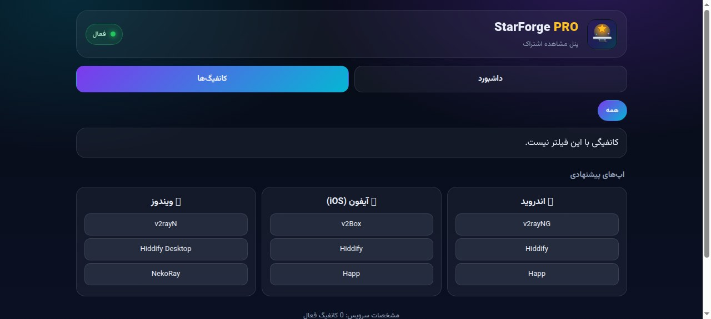
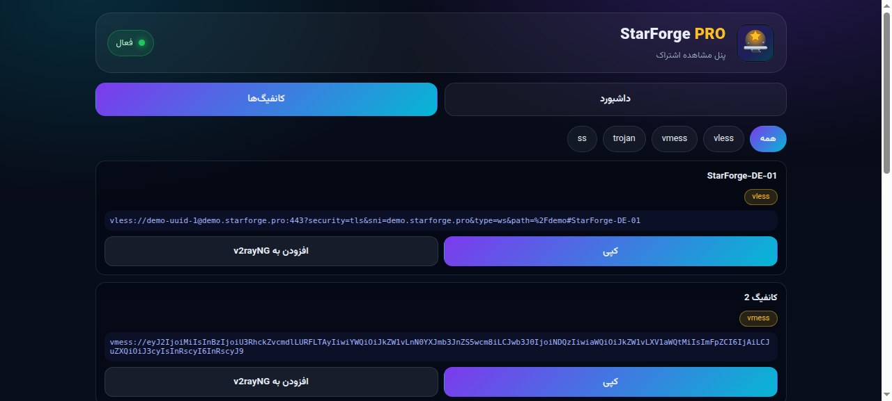

# StarForge PRO — صفحه اشتراک

یه صفحه‌ی استاتیک تک‌فایل، تیره و شیشه‌ای، کاملاً فارسی و راست‌چین — برای اینکه
کاربر لینک اشتراکش رو ببینه، کپی کنه، QR بگیره و با یه tap بندازه توی اپ.

This is a static single-page subscription viewer. Open it on the subscription link
itself, or with `?sub=<url>`. No backend, GitHub Pages ready.

## راه‌اندازی سریع

| کار | چطور |
|---|---|
| پیش‌نمایش لوکال | `python3 -m http.server` توی همین پوشه، بعد باز کردن `index.html` |
| اشتراک واقعی | `index.html?sub=https://...` |
| انتشار | پوش به برنچ `main` → ورک‌فلوی Pages خودش منتشر می‌کنه |

## ساختار

| فایل | نقش |
|---|---|
| `index.html` | کل صفحه (استایل + منطق داخل خودش) |
| `assets/logo.svg` | لوگوی اورجینال سندان فضایی + ستاره |
| `data/config.json` | متای برند و لیست اپ‌ها |
| `scripts/style_audit.py` | چک‌لیست ضد نشت برند (`python3 scripts/style_audit.py`) |
| `docs/` | اسکرین‌شات‌ها |

## پیش‌نمایش

| داشبورد | کانفیگ‌ها |
|---|---|
|  |  |

## لینک مستقیم

پایین صفحه یه کارت «لینک مستقیم این بخش» هست که آدرس همین صفحه (همون لینک اشتراکی
که کاربر باهاش اومده) رو نشون می‌ده و با یه دکمه کپی می‌شه.

## نکته مهم درباره CORS

سرور اشتراک هدر CORS نمی‌ده، پس `fetch` مستقیم از مرورگر معمولاً fail می‌شه.
راه‌حل: صفحه رو از همون دامنهٔ پنل باز کن (same-origin).

## پشتیبانی

https://t.me/master_supports

## Credits

Inspired by the classic bento-style subscription panel layout — this page is an
original implementation (own code, own logo, own styles), not a copy.

## License

MIT © 2026 frank0live — see `LICENSE`.
